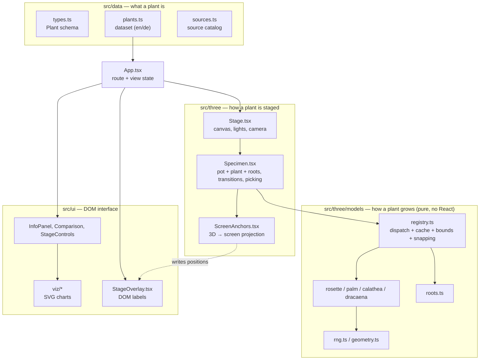

# Architecture

How Plantarium is put together and how data flows from a plant entry to the
pixels on screen. The README gives the short version; this document explains
the reasoning a maintainer needs to change the code safely. Decisions behind
the structure are recorded in [`DECISIONS/`](DECISIONS/README.md).

## In one paragraph

Plantarium is a static single-page app (Vite, React 19, TypeScript, three.js
via React Three Fiber). There is no backend: every plant is one typed entry in
`src/data/plants.ts`. The UI reads that entry directly for text and SVG charts;
the 3D stage turns the entry's model parameters into geometry with a
deterministic procedural generator, renders it, and projects 3D anchor points
onto ordinary DOM labels. URL hash, view mode and toggles live as React state
in `App.tsx`.

## Layers and their boundaries

Rules that keep this maintainable (enforced by review, see `AGENTS.md`):

- `src/data` knows nothing about rendering.
- `src/three/models` returns plain `THREE.BufferGeometry`; no React, no scene
  state, no `Math.random()`.
- `src/three` stages geometry; `src/ui` never touches the scene directly.
- Plant-specific behaviour comes from data, never from `if (plant.id === …)`.

## Data flow, step by step

1. **Route.** `useHashNavigation` parses the URL hash (`#pflanze/<id>` or
   `#vergleich/<id>`, see `navigation.ts`) into `{ page, plantId }`. Unknown
   ids fall back to the first plant, so every URL resolves.
2. **View state.** `App.tsx` owns view mode (`plant` / `roots` / `anatomy`),
   pot and soil options, day time, selected and hovered anatomy region and
   camera commands. Changing route resets the selection so a region from the
   previous plant can never be shown on the next one.
3. **Lazy stage.** `Stage` is loaded with `React.lazy`; three.js is most of
   the bundle, so the specimen sheet and controls paint before WebGL is ready.
   `StageBoundary` catches stage failures and shows a fallback.
4. **Geometry.** For `model.kind: 'procedural'`, `buildProceduralGeometry`
   (`registry.ts`) seeds an RNG with `model.seed`, dispatches on
   `params.type` to a generator and grows roots from the returned
   `rootOrigins` with a second seed. The result is split into four regions —
   `leaves`, `stems`, `crown`, `roots` — so each can be highlighted and
   picked. It is cached in a `WeakMap` keyed by the plant object, which is why
   plant records are treated as immutable.
5. **GLB alternative.** For `model.kind: 'gltf'`, `PlantModel.tsx` loads the
   file and shows the procedural `fallback` while loading or after an error.
   Some effects (root glow, snapping, measured ruler) only exist for
   procedural models; see the GLB section of the README.
6. **Staging.** `Specimen.tsx` combines vessel (`Vessel.tsx`), plant and roots,
   applies region materials (`materials.ts`, including the foliage wind and
   pose shader), animates plant switches (`specimen-transition.ts`) and handles
   picking. `Stage.tsx` frames the camera from robust bounds
   (`plantBounds`: ignores the top 0.5 % of vertices so a single stray leaf
   does not shrink the view).
7. **Labels.** Hotspots and ruler ticks are 3D points. DOM elements in
   `ui/StageOverlay.tsx` register themselves in `anchorRegistry.ts`;
   `ScreenAnchors.tsx` projects each point every frame and moves the element.
   Text stays crisp, selectable, translatable and accessible.
8. **Sheet and comparison.** `InfoPanel` and `Comparison` render the same
   entry with small SVG graphics from `ui/viz/`; layout math lives in pure
   helpers (`chart-layout.ts`, `comparison-scale.ts`) so it can be unit-tested.

## Localization

UI strings are in `src/i18n/messages.ts` (English is the reference); plant
texts are `Localized` values (`{ en, de }`) inside the data. `LocaleProvider`
stores the choice and keeps `<html lang>`, title and description in sync.
Unit tests fail when a language is missing.

## Testing layers

| Layer | Where | What it protects |
|---|---|---|
| Unit (Vitest) | `tests/unit/` | Data completeness and invariants, deterministic geometry, navigation parsing, chart and comparison math, transitions |
| Browser (Playwright, dev server) | `tests/browser/*.spec.ts` | Rendering, navigation, language switch, vessel toggles, GLB loading and failure recovery, charts |
| Production smoke | `playwright.production.config.ts` | The bundled build on desktop and mobile, including visible foliage and touch orbiting |
| Benchmark | `npm run benchmark:geometry` | Geometry build time and size (manual) |
| Workflow (`node --test`) | `scripts/workflow/*.test.mjs` | Development tooling only: session hook, board merge driver, Claude Code config |

CI (`.github/workflows/ci.yml`) runs lint, build, unit and browser tests on
every pull request and on `main`. `.github/workflows/workflow-checks.yml` runs
the workflow tests on Linux and Windows when workflow files change; they do
not touch the app (see [WORKFLOW.md](WORKFLOW.md)).

## Where to start when changing…

- **A plant's values or texts:** `src/data/plants.ts` (both languages, keep
  `dataQuality: 'placeholder'` unless actually reviewed).
- **A growth form:** its generator in `src/three/models/`; check every plant
  that uses it, since all of them change.
- **A new growth form:** new generator + params type in `src/data/types.ts` +
  dispatch in `registry.ts`.
- **Camera or framing:** `Stage.tsx` and `plantBounds` in `registry.ts`.
- **Labels and hotspots:** `anchorRegistry.ts`, `ScreenAnchors.tsx`,
  `ui/StageOverlay.tsx`.
- **Charts:** `src/ui/viz/` and `chart-layout.ts`.
